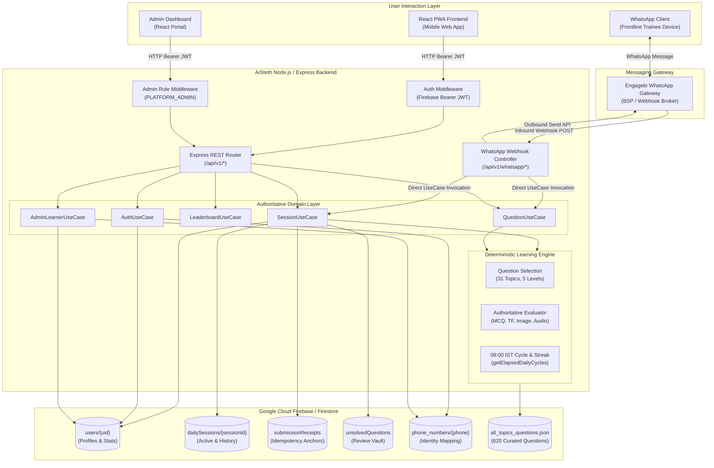
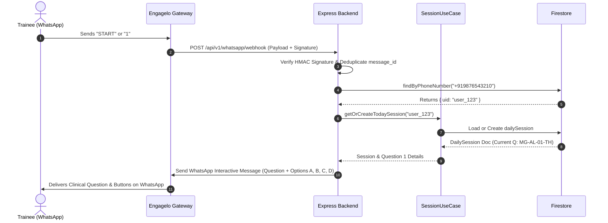
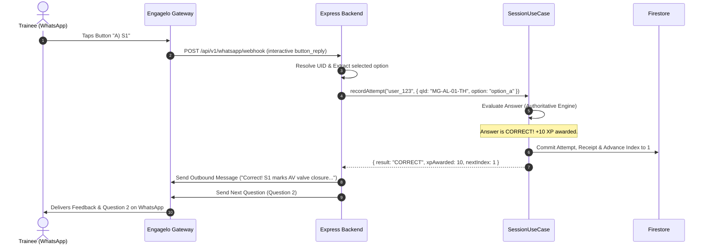
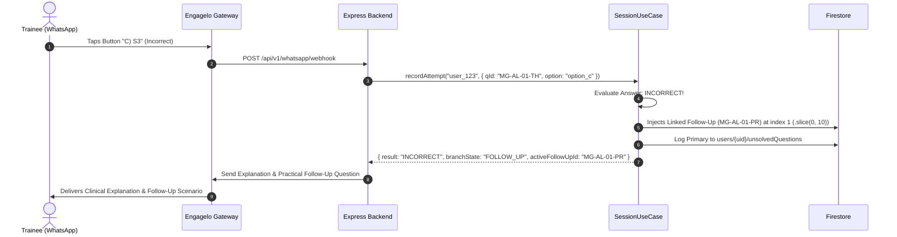
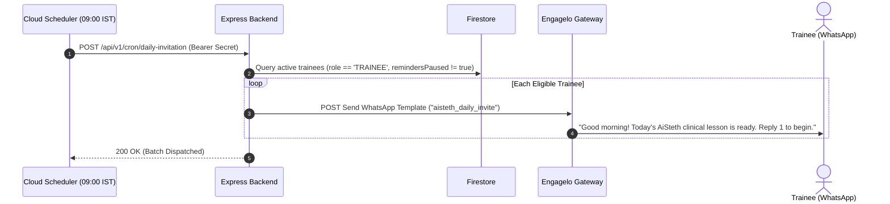
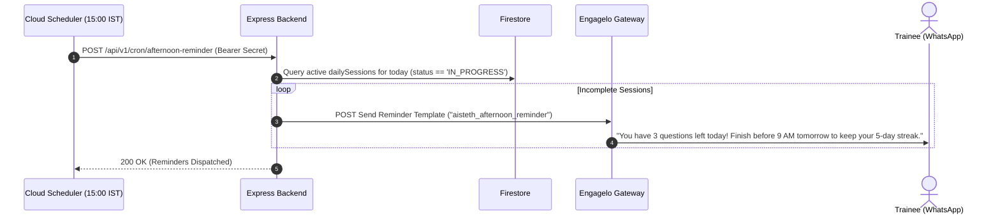
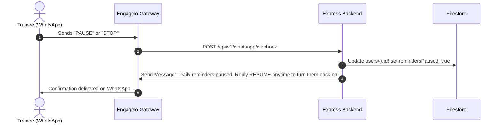
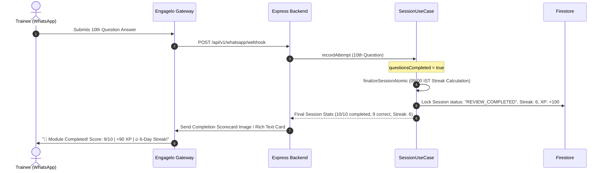
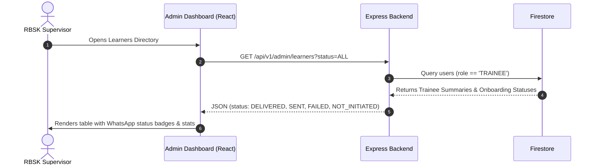

# AiSteth Academy — Complete WhatsApp Integration API Documentation
**Document:** `WHATSAPP_INTEGRATION_API_DOCUMENTATION.md`  
**Target:** WhatsApp Conversational Learning Experience via Engagelo Gateway  
**Base Architecture:** Node.js / Express Clean Architecture + Firebase/Firestore  
**Authoritative Engine:** AiSteth RBSK Learning Engine (620-Question Clinical Curriculum)  
**Date:** October 2026  
**Status:** Architecture Specification & Code Audit (Phase 1 & 2 Completed; WhatsApp Phase Ready)

---

## 1. Document Overview

### 1.1 Purpose
This document provides the definitive architectural blueprint, code audit, and API contract specification for integrating the **AiSteth Academy** learning engine with a conversational **WhatsApp** interface via **Engagelo** (the designated WhatsApp Business Solution Provider / Gateway).

### 1.2 Core Architectural Principles
1. **Single Authoritative Learning Engine**: The learning engine, state machine, adaptive 31-topic curriculum progression, question selection, answer evaluation, follow-up branching, XP calculation, and daily streak rules reside **strictly on the backend**. There must never be duplicate learning logic written inside Engagelo or WhatsApp bots.
2. **Channel Symmetry**: Both the existing React PWA frontend and the forthcoming WhatsApp conversational interface share the exact same domain use cases ([`SessionUseCase`](file:///c:/Users/I%20Health%20Highway/Downloads/TARUN%20PROJECT/acad/backend/src/application/usecases/SessionUseCase.ts), [`QuestionUseCase`](file:///c:/Users/I%20Health%20Highway/Downloads/TARUN%20PROJECT/acad/backend/src/application/usecases/QuestionUseCase.ts), [`AuthUseCase`](file:///c:/Users/I%20Health%20Highway/Downloads/TARUN%20PROJECT/acad/backend/src/application/usecases/AuthUseCase.ts)) and Firestore data models. A learner answering via WhatsApp advances their daily session and streak identically to a learner answering via the React web app.
3. **Decoupled Messaging Transport**: Engagelo acts solely as the messaging transport, webhook dispatcher, and media gateway. The backend evaluates learner inputs and instructs Engagelo which messages, interactive buttons, or cards to deliver.
4. **Phone-Number-Anchored Identity**: For frontline healthcare workers (ASHA, ANM, CHO, Medical Officers), the mobile number is the primary identity. The backend maps canonical E.164 phone numbers (`+91XXXXXXXXXX`) to internal learner UIDs.

---

## 2. Project Architecture

The complete system architecture and communication pathways are illustrated below:



### 2.1 Component Communication Responsibilities
1. **React Learner Frontend**: Interacts with the backend over REST via `src/api/client.ts` using in-memory Firebase Auth ID tokens (`Authorization: Bearer <idToken>`) and `HttpOnly` refresh cookies.
2. **WhatsApp Learner Interface (via Engagelo)**: Frontline trainees send text messages or press interactive WhatsApp buttons. Engagelo converts these into HTTP webhook payloads delivered to the backend.
3. **Node.js/Express Backend**: Authoritative core. Verifies Engagelo webhook signatures, resolves the sender's phone number to a UID, runs domain use cases, and generates outbound responses.
4. **Existing Learning Engine**: Pure domain logic. Enforces 10-slot daily sequences, adaptive 31-topic progression across 5 clinical levels, authoritative question evaluation, follow-up injection, 09:00 IST daily cycle boundaries, and atomic streak updates.
5. **Firebase / Firestore**: Serverless persistent store hosting learner profiles, active daily sessions, submission idempotency receipts, unsolved questions, and phone number indexes.
6. **Admin Dashboard**: React portal for supervisors to manage cohorts, register trainees (single & bulk CSV), inspect clinical progress, and dispatch onboarding invites.
7. **Engagelo Messaging Service**: Connects to the Meta WhatsApp Business Cloud API. Dispatches pre-approved HSM templates, handles two-way session messages within the 24-hour window, and posts inbound messages/delivery receipts to the backend.

---

## 3. Current API Inventory

The repository currently defines **24 verified backend API endpoints** across 5 router files and the core application entry point.

### Summary Table of Verified Existing Endpoints

| Category | Method | Route Path | Source File | Auth Required | WhatsApp Relevance |
| :--- | :--- | :--- | :--- | :--- | :--- |
| **System** | `GET` | `/api/v1/health` | [`backend/src/app.ts:L46`](file:///c:/Users/I%20Health%20Highway/Downloads/TARUN%20PROJECT/acad/backend/src/app.ts#L46) | Public | Indirect (Monitoring) |
| **Auth** | `POST` | `/api/v1/auth/register` | [`auth.routes.ts:L7`](file:///c:/Users/I%20Health%20Highway/Downloads/TARUN%20PROJECT/acad/backend/src/api/routes/auth.routes.ts#L7) | Public | Indirect (Self-enrollment) |
| **Auth** | `POST` | `/api/v1/auth/login` | [`auth.routes.ts:L8`](file:///c:/Users/I%20Health%20Highway/Downloads/TARUN%20PROJECT/acad/backend/src/api/routes/auth.routes.ts#L8) | Public | Indirect (Web login) |
| **Auth** | `POST` | `/api/v1/auth/refresh` | [`auth.routes.ts:L9`](file:///c:/Users/I%20Health%20Highway/Downloads/TARUN%20PROJECT/acad/backend/src/api/routes/auth.routes.ts#L9) | Cookie | Unrelated (Web session) |
| **Auth** | `POST` | `/api/v1/auth/logout` | [`auth.routes.ts:L10`](file:///c:/Users/I%20Health%20Highway/Downloads/TARUN%20PROJECT/acad/backend/src/api/routes/auth.routes.ts#L10) | Optional Bearer | Unrelated (Web session) |
| **Auth** | `POST` | `/api/v1/auth/forgot-password` | [`auth.routes.ts:L19`](file:///c:/Users/I%20Health%20Highway/Downloads/TARUN%20PROJECT/acad/backend/src/api/routes/auth.routes.ts#L19) | Public | Unrelated (Web password) |
| **Sessions** | `GET` | `/api/v1/sessions/today` | [`session.routes.ts:L9`](file:///c:/Users/I%20Health%20Highway/Downloads/TARUN%20PROJECT/acad/backend/src/api/routes/session.routes.ts#L9) | Bearer JWT | **Direct** (Session init/recovery) |
| **Sessions** | `POST` | `/api/v1/sessions/today/attempts` | [`session.routes.ts:L10`](file:///c:/Users/I%20Health%20Highway/Downloads/TARUN%20PROJECT/acad/backend/src/api/routes/session.routes.ts#L10) | Bearer JWT | **Direct** (Answer submission) |
| **Sessions** | `POST` | `/api/v1/sessions/today/finalize` | [`session.routes.ts:L11`](file:///c:/Users/I%20Health%20Highway/Downloads/TARUN%20PROJECT/acad/backend/src/api/routes/session.routes.ts#L11) | Bearer JWT | **Direct** (Session completion) |
| **Questions** | `GET` | `/api/v1/questions/today` | [`question.routes.ts:L9`](file:///c:/Users/I%20Health%20Highway/Downloads/TARUN%20PROJECT/acad/backend/src/api/routes/question.routes.ts#L9) | Bearer JWT | Indirect (Question pool) |
| **Questions** | `GET` | `/api/v1/questions/unsolved` | [`question.routes.ts:L10`](file:///c:/Users/I%20Health%20Highway/Downloads/TARUN%20PROJECT/acad/backend/src/api/routes/question.routes.ts#L10) | Bearer JWT | **Direct** (Review queue) |
| **Questions** | `PATCH` | `/api/v1/questions/unsolved/:id` | [`question.routes.ts:L11`](file:///c:/Users/I%20Health%20Highway/Downloads/TARUN%20PROJECT/acad/backend/src/api/routes/question.routes.ts#L11) | Bearer JWT | **Direct** (Resolve review) |
| **Questions** | `GET` | `/api/v1/questions/follow-up/:id` | [`question.routes.ts:L12`](file:///c:/Users/I%20Health%20Highway/Downloads/TARUN%20PROJECT/acad/backend/src/api/routes/question.routes.ts#L12) | Bearer JWT | **Direct** (Fetch linked follow-up) |
| **Questions** | `GET` | `/api/v1/questions/:id` | [`question.routes.ts:L13`](file:///c:/Users/I%20Health%20Highway/Downloads/TARUN%20PROJECT/acad/backend/src/api/routes/question.routes.ts#L13) | Bearer JWT | **Direct** (Fetch question details) |
| **Users** | `GET` | `/api/v1/users/me` | [`user.routes.ts:L9`](file:///c:/Users/I%20Health%20Highway/Downloads/TARUN%20PROJECT/acad/backend/src/api/routes/user.routes.ts#L9) | Bearer JWT | **Direct** (Profile & Stats) |
| **Users** | `PATCH` | `/api/v1/users/me` | [`user.routes.ts:L10`](file:///c:/Users/I%20Health%20Highway/Downloads/TARUN%20PROJECT/acad/backend/src/api/routes/user.routes.ts#L10) | Bearer JWT | Indirect (Update details) |
| **Users** | `GET` | `/api/v1/users/leaderboard` | [`user.routes.ts:L11`](file:///c:/Users/I%20Health%20Highway/Downloads/TARUN%20PROJECT/acad/backend/src/api/routes/user.routes.ts#L11) | Bearer JWT | **Direct** (Ranks & scores) |
| **Admin** | `GET` | `/api/v1/admin/overview` | [`admin.routes.ts:L12`](file:///c:/Users/I%20Health%20Highway/Downloads/TARUN%20PROJECT/acad/backend/src/api/routes/admin.routes.ts#L12) | Admin Role | Indirect (Dashboard stats) |
| **Admin** | `GET` | `/api/v1/admin/learners` | [`admin.routes.ts:L13`](file:///c:/Users/I%20Health%20Highway/Downloads/TARUN%20PROJECT/acad/backend/src/api/routes/admin.routes.ts#L13) | Admin Role | Indirect (Directory search) |
| **Admin** | `GET` | `/api/v1/admin/learners/:uid` | [`admin.routes.ts:L14`](file:///c:/Users/I%20Health%20Highway/Downloads/TARUN%20PROJECT/acad/backend/src/api/routes/admin.routes.ts#L14) | Admin Role | Indirect (Learner inspection) |
| **Admin** | `POST` | `/api/v1/admin/learners` | [`admin.routes.ts:L15`](file:///c:/Users/I%20Health%20Highway/Downloads/TARUN%20PROJECT/acad/backend/src/api/routes/admin.routes.ts#L15) | Admin Role | **Direct** (Trainee provisioning) |
| **Admin** | `POST` | `/api/v1/admin/learners/bulk` | [`admin.routes.ts:L16`](file:///c:/Users/I%20Health%20Highway/Downloads/TARUN%20PROJECT/acad/backend/src/api/routes/admin.routes.ts#L16) | Admin Role | **Direct** (Cohort CSV import) |
| **Admin** | `POST` | `/api/v1/admin/learners/:uid/whatsapp-onboard` | [`admin.routes.ts:L17`](file:///c:/Users/I%20Health%20Highway/Downloads/TARUN%20PROJECT/acad/backend/src/api/routes/admin.routes.ts#L17) | Admin Role | **Direct** (Single invite trigger) |
| **Admin** | `POST` | `/api/v1/admin/learners/bulk-whatsapp-onboard` | [`admin.routes.ts:L18`](file:///c:/Users/I%20Health%20Highway/Downloads/TARUN%20PROJECT/acad/backend/src/api/routes/admin.routes.ts#L18) | Admin Role | **Direct** (Bulk invite trigger) |

---

### 3.1 Detailed Endpoint Specifications (Existing)

#### `GET /api/v1/sessions/today`
- **Purpose**: Creates or retrieves the learner's active daily session for today's 09:00 IST cycle.
- **Route File**: [`backend/src/api/routes/session.routes.ts`](file:///c:/Users/I%20Health%20Highway/Downloads/TARUN%20PROJECT/acad/backend/src/api/routes/session.routes.ts)
- **Controller**: `SessionController.getTodaySession`
- **Authentication**: Required (`authMiddleware`, Bearer JWT)
- **Query Parameters**: `date` (optional, string `YYYY-MM-DD`). Defaults to active 09:00 IST cycle date.
- **Response Payload**:
  ```json
  {
    "session": {
      "sessionId": "daily_2026-10-23_trainee1",
      "uid": "user_12345",
      "localDate": "2026-10-23",
      "contentReleaseId": "rel_v1_0_0",
      "status": "IN_PROGRESS",
      "questionIds": ["MG-AL-01-TH", "MG-AS-01-TH", "..."],
      "currentQuestionIndex": 0,
      "questionsCompleted": false,
      "reviewViewed": false,
      "totalXpEarned": 0,
      "correctCount": 0,
      "branchState": "MAIN",
      "activeFollowUpQuestionId": null
    },
    "currentQuestion": {
      "question_id": "MG-AL-01-TH",
      "type": "MCQ",
      "category": "HEART_RECORDING",
      "question": "Which heart sound corresponds to closure of AV valves?",
      "option_a": "S1",
      "option_b": "S2",
      "option_c": "S3",
      "option_d": "S4"
    },
    "isNewSession": false
  }
  ```
- **Error Responses**: `401 Unauthorized`, `500 Internal Server Error`.
- **Database Reads/Writes**: Reads `users/{uid}`, queries/creates `users/{uid}/dailySessions/{sessionId}`.

#### `POST /api/v1/sessions/today/attempts`
- **Purpose**: Server-authoritative answer submission. Evaluates correctness, updates XP, manages follow-up branching, and commits an atomic idempotency receipt.
- **Route File**: [`backend/src/api/routes/session.routes.ts`](file:///c:/Users/I%20Health%20Highway/Downloads/TARUN%20PROJECT/acad/backend/src/api/routes/session.routes.ts)
- **Controller**: `SessionController.recordAttempt`
- **Authentication**: Required (`authMiddleware`, Bearer JWT)
- **Request Body**:
  ```json
  {
    "sessionId": "daily_2026-10-23_trainee1",
    "questionId": "MG-AL-01-TH",
    "questionIndex": 0,
    "userAnswerPayload": {
      "type": "MCQ",
      "selected_option": "option_a"
    },
    "idempotencyKey": "idem_daily_2026-10-23_trainee1_q0_MAIN_optA",
    "selectedOption": "option_a",
    "branchState": "MAIN"
  }
  ```
- **Response Payload**:
  ```json
  {
    "attemptId": "att_daily_2026-10-23_trainee1_q0_MAIN",
    "currentQuestionIndex": 1,
    "isSessionComplete": false,
    "totalXpEarned": 10,
    "correctCount": 1,
    "result": "CORRECT",
    "xpAwarded": 10,
    "branchState": "MAIN",
    "status": "IN_PROGRESS",
    "questionsCompleted": false,
    "activeFollowUpQuestionId": null
  }
  ```
- **Error Responses**: `400 Bad Request`, `401 Unauthorized`, `404 Not Found`, `409 Conflict` (idempotency replay mismatch, out-of-order index, terminal session).
- **Database Reads/Writes**: Atomically writes `users/{uid}/attempts/{attemptId}`, updates `users/{uid}/dailySessions/{sessionId}`, updates `users/{uid}` stats, writes `submissionReceipts/{idempotencyKey}`.

#### `POST /api/v1/sessions/today/finalize`
- **Purpose**: Atomically locks completed session, calculates consecutive streak against the 09:00 IST cycle, and resets active session pointers.
- **Route File**: [`backend/src/api/routes/session.routes.ts`](file:///c:/Users/I%20Health%20Highway/Downloads/TARUN%20PROJECT/acad/backend/src/api/routes/session.routes.ts)
- **Controller**: `SessionController.finalizeSession`
- **Authentication**: Required (`authMiddleware`, Bearer JWT)
- **Request Body**:
  ```json
  {
    "sessionId": "daily_2026-10-23_trainee1",
    "totalXpEarned": 100,
    "correctCount": 10,
    "totalQuestions": 10
  }
  ```
- **Response Payload**:
  ```json
  {
    "success": true,
    "alreadyFinalized": false,
    "updatedLearningState": {
      "totalXp": 250,
      "currentStreak": 5,
      "longestStreak": 7,
      "lastActiveDate": "2026-10-23",
      "completedSessionsCount": 8,
      "completedQuestionsCount": 80,
      "totalCorrectAnswersCount": 75,
      "currentLevel": 2
    }
  }
  ```
- **Idempotency**: Repeated calls return `{ "success": false, "alreadyFinalized": true }` with zero duplicate XP or streak increments.

---

## 4. Existing Endpoints Reusable for WhatsApp

### 4.1 In-Process UseCase Invocation vs REST Wrapping
While the REST endpoints `/api/v1/sessions/*` exist and work, **wrapping them over internal HTTP loops for WhatsApp is an anti-pattern**:
- `authMiddleware` demands a Firebase Auth ID Token (`Authorization: Bearer <idToken>`).
- WhatsApp webhook messages arrive from Engagelo signed with HMAC signatures without any client Bearer tokens.
- **Recommended Architectural Design**:
  The new `WhatsAppWebhookController` will parse incoming Engagelo messages, verify provider authenticity, resolve the learner UID via [`defaultUserRepository.findByPhoneNumber`](file:///c:/Users/I%20Health%20Highway/Downloads/TARUN%20PROJECT/acad/backend/src/infrastructure/firestore/FirestoreUserRepository.ts#L281), and invoke the underlying use cases **directly in-process**:
  - `sessionUseCase.getOrCreateTodaySession(uid)`
  - `sessionUseCase.recordAttempt(uid, payload)`
  - `sessionUseCase.finalizeSession(uid, payload)`
  - `questionUseCase.getQuestionById(questionId)`
  - `questionUseCase.getUnsolvedQuestions(uid)`
  - `authUseCase.getUserProfileAndStats(uid)`

This guarantees **zero duplicate business logic**, **sub-millisecond latency**, and **strict type safety** without synthetic token minting.

---

## 5. Proposed WhatsApp Integration Endpoints

To connect Engagelo with the AiSteth learning engine, the following 6 endpoints are proposed:

### Proposed Endpoint Master Register

| ID | Method | Proposed Route | Purpose | Category | Called By | Priority | Dependencies |
| :--- | :--- | :--- | :--- | :--- | :--- | :--- | :--- |
| **WA-001** | `GET` | `/api/v1/whatsapp/webhook` | Webhook verification handshake | **C** (Proposed) | Engagelo / Meta | **P0** | Verification token |
| **WA-002** | `POST` | `/api/v1/whatsapp/webhook` | Inbound message & event receiver | **C** (Proposed) | Engagelo | **P0** | HMAC Signature verification, `findByPhoneNumber`, `SessionUseCase` |
| **WA-003** | `POST` | `/api/v1/whatsapp/send-message` | Manual/Admin outbound trigger | **B** (Extends existing stub) | Admin portal / Backend internal | **P1** | Engagelo Outbound API |
| **WA-004** | `POST` | `/api/v1/cron/daily-invitation` | 09:00 IST invitation batch dispatcher | **C** (Proposed) | Cloud Scheduler / Cron runner | **P1** | Secret key auth, Firestore querying |
| **WA-005** | `POST` | `/api/v1/cron/afternoon-reminder` | 15:00 IST incomplete session reminder | **C** (Proposed) | Cloud Scheduler / Cron runner | **P1** | Secret key auth, session status filtering |
| **WA-006** | `GET` | `/api/v1/whatsapp/health` | Engagelo integration liveness & status | **C** (Proposed) | Monitoring systems / Admin | **P2** | External ping to Engagelo |

*Category Legend:*  
- **A**: Existing endpoint verified in code.  
- **B**: Existing endpoint requiring adaptation/extension.  
- **C**: Proposed new endpoint.  
- **D**: Provider-dependent endpoint requiring Engagelo confirmation.  

---

## 6. Endpoint Request/Response Reference (Proposed Endpoints)

### `WA-001: GET /api/v1/whatsapp/webhook`
- **Purpose**: Webhook verification challenge (standard Meta / Engagelo webhook subscription verification).
- **Authentication**: Verification Token match (`hub.verify_token`).
- **Query Parameters**:
  - `hub.mode`: string (`"subscribe"`)
  - `hub.challenge`: string (random challenge integer/string)
  - `hub.verify_token`: string (configured in backend environment)
- **Response**: Plain text response returning `hub.challenge` with HTTP 200.

### `WA-002: POST /api/v1/whatsapp/webhook`
- **Purpose**: Receives incoming trainee WhatsApp messages, interactive button clicks, and message status updates from Engagelo.
- **Authentication**: HMAC-SHA256 signature in request header (`X-Hub-Signature-256` or Engagelo API signature).
- **Request Body (Illustrative Standard WhatsApp/Engagelo Inbound Payload)**:
  ```json
  {
    "object": "whatsapp_business_account",
    "entry": [
      {
        "id": "ENGAGELO_ACCOUNT_ID",
        "changes": [
          {
            "field": "messages",
            "value": {
              "messaging_product": "whatsapp",
              "contacts": [
                {
                  "profile": { "name": "ASHA Suman" },
                  "wa_id": "919876543210"
                }
              ],
              "messages": [
                {
                  "from": "919876543210",
                  "id": "wamid.HBgMOTE5ODc2NTQzMjEwFQIAEhgWM0VCMDE...",
                  "timestamp": "1730000000",
                  "type": "interactive",
                  "interactive": {
                    "type": "button_reply",
                    "button_reply": {
                      "id": "ANS_option_a",
                      "title": "A) S1"
                    }
                  }
                }
              ]
            }
          }
        ]
      }
    ]
  }
  ```
- **Response**: HTTP `200 OK` (`{ "status": "RECEIVED" }`).  
  *(Asynchronous processing resolves learner UID, executes `recordAttempt`, and dispatches the outbound WhatsApp reply).*

### `WA-004: POST /api/v1/cron/daily-invitation`
- **Purpose**: Triggered at 09:00:00 IST daily by an automated scheduler to dispatch daily learning invitations.
- **Authentication**: Shared Bearer Secret (`Authorization: Bearer <CRON_SECRET_KEY>`).
- **Request Body**:
  ```json
  {
    "cycleDate": "2026-10-23",
    "batchSize": 100
  }
  ```
- **Response Payload**:
  ```json
  {
    "success": true,
    "cycleDate": "2026-10-23",
    "totalEligible": 450,
    "dispatched": 450,
    "skippedPaused": 12,
    "failed": 0
  }
  ```

---

## 7. Engagelo Integration & Provider Dependencies

### 7.1 Current Status in Codebase
A comprehensive audit of the workspace reveals **zero existing references to Engagelo** in code or documentation. The existing [`WhatsAppOnboardingService.ts`](file:///c:/Users/I%20Health%20Highway/Downloads/TARUN%20PROJECT/acad/backend/src/infrastructure/external/WhatsAppOnboardingService.ts) contains a stub calling Meta Cloud API directly (`https://graph.facebook.com/v21.0/${phoneNumberId}/messages`).

### 7.2 Necessary Provider Specifications to Confirm from Engagelo
Before Phase 2 implementation begins, the Engagelo technical team must supply:
1. **API Protocol**: Does Engagelo provide a proprietary REST API (`https://api.engagelo.com/v1/...`) or does it proxy standard Meta Graph API endpoints?
2. **Inbound Webhook Payload Format**: Does Engagelo forward raw Meta Cloud webhook structures (`entry[0].changes[0].value.messages`) or normalize them into a custom JSON payload?
3. **Webhook Authentication Mechanism**: Does Engagelo sign payloads using HMAC-SHA256 with a shared secret, provide an `X-Engagelo-Token` header, or rely on mutual TLS?
4. **Interactive Message Types**: Support for WhatsApp Interactive Buttons (maximum 3 buttons) and Interactive Section Lists (up to 10 choices) for 4-option MCQs.
5. **Template Pre-Approval Requirements**: Pre-approved HSM message templates for the 09:00 IST invitation and 15:00 IST reminder to initiate communication outside the 24-hour service window.

---

## 8. Webhooks and Callback Handling

### 8.1 Inbound Message Router & State Machine
The backend webhook handler must route incoming messages based on learner intent:

```
[Inbound WhatsApp Message]
       │
       ▼
[Verify Signature & Deduplicate message_id]
       │
       ▼
[Resolve Learner via phone_numbers/{phone}]
       ├── Unknown Phone ──► Reply: "Number not registered. Contact RBSK Supervisor."
       │
       ▼
[Parse Message Type]
       ├── "START" / "TODAY" / "HI" ──► Start/Resume Daily Session -> Send Current Q
       ├── "A" / "B" / "C" / "D" (or Button click) ──► Submit Answer -> Send Feedback & Next Q
       ├── "PAUSE" / "STOP" ──► Set remindersPaused: true -> Confirm Pause
       ├── "RESUME" ──► Set remindersPaused: false -> Confirm Resume
       ├── "SCORE" / "STREAK" ──► Fetch Profile/Stats -> Send Progress Card
       └── Invalid / Unrecognized ──► Send Contextual Help & Current Question prompt
```

### 8.2 Delivery Receipts & Failure Callbacks
Engagelo delivery events (`sent`, `delivered`, `read`, `failed`) posted to the webhook should update:
- `users/{uid}.onboardingStatus` (`DELIVERED`, `FAILED`, `SENT`).
- `users/{uid}.onboardingError` (logged if delivery fails, e.g. "User not on WhatsApp" or "Template rejected").

---

## 9. Daily Learning Workflow & Follow-Up Sequencing

### 9.1 Authoritative 10-Question Sequence Rule
An inspection of [`FirestoreSessionRepository.ts:L455-497`](file:///c:/Users/I%20Health%20Highway/Downloads/TARUN%20PROJECT/acad/backend/src/infrastructure/firestore/FirestoreSessionRepository.ts#L455-L497) reveals how the existing engine sequences follow-up questions:
1. **Capped at Exactly 10 Slots**: The daily learning sequence has a hard cap of 10 question slots (`.slice(0, 10)`).
2. **Primary Correct**: If a Primary question is answered correctly, the session advances to the next slot (`currentIndex + 1`) and awards +10 XP (up to the 310 XP curriculum limit).
3. **Primary Incorrect & Follow-Up Injection**: If a Primary question is failed at slots 1 through 9 (`currentIndex < 9`):
   - The engine retrieves the authoritatively linked practical follow-up question (`getFollowUpQuestion(activePrimaryId)`).
   - The follow-up is **injected into the next sequence slot** (`currentIndex + 1`).
   - The sequence is truncated to 10 (`updatedQIds = [...].slice(0, 10)`). **This means the injected follow-up consumes one of today's 10 daily slots**, pushing the 10th primary question to a future day!
   - `branchState` transitions to `'FOLLOW_UP'`.
   - The primary question is simultaneously saved to `users/{uid}/unsolvedQuestions` for review in the Unsolved Clinical Vault.
4. **Failure on Slot 10 (Edge Case)**: If a Primary question is failed on slot 10 (`currentIndex === 9`, `isFinalSlot === true`), the engine **does not inject an 11th slot**. The session concludes immediately (`QUESTIONS_COMPLETED`), and the question is recorded in `unsolvedQuestions`.

---

## 10. Scheduling and Reminders

```mermaid
timeline
    title Daily RBSK Trainee WhatsApp Schedule (Asia/Kolkata)
    09:00 IST : Daily Cycle Resets : 09:00 AM Invitation Sent : 10 Questions Queued
    12:00 IST : Normal Learning Window : Trainees complete lessons during field breaks
    15:00 IST : Afternoon Audit : Check Incomplete Sessions : 15:00 PM Reminder Sent
    21:00 IST : Evening Catch-Up : Unsolved Questions Vault Review
    Next 09:00 IST : Cycle Rolls Over : Streaks incremented or reset
```

### 10.1 09:00 AM IST Daily Invitation
- **Trigger**: Cloud Scheduler cron `0 9 * * *` (in `Asia/Kolkata` timezone).
- **Target Audience**: All active trainees with `role: "TRAINEE"`, `onboardingStatus: "ACTIVE"` (or `"DELIVERED"`), and `remindersPaused !== true`.
- **Content**: Pre-approved HSM template announcing today's clinical topic (e.g. *"Good morning Dr. / Sister! Today's AiSteth module on Cyanosis & CHD is ready. Reply 1 to begin."*).

### 10.2 03:00 PM IST Incomplete Session Reminder
- **Trigger**: Cloud Scheduler cron `0 15 * * *` (in `Asia/Kolkata` timezone).
- **Filter Criteria**:
  1. Trainee has not finalized today's session (`status !== 'COMPLETED'` and `status !== 'REVIEW_COMPLETED'`).
  2. Trainee has `remindersPaused !== true`.
  3. Trainee has not opted out.
- **Content**: Reminder indicating remaining questions (e.g. *"You have 4 questions remaining in today's module. Complete them before 9:00 AM tomorrow to keep your 5-day streak alive! Reply GO to resume."*).

---

## 11. Authentication and Security

### 11.1 Security Matrix Across Channels

| Aspect | React PWA Web App | WhatsApp via Engagelo |
| :--- | :--- | :--- |
| **Authentication Credential** | Firebase ID Token (`Bearer <idToken>`) | Verified WhatsApp Mobile Phone (`from: "+91..."`) |
| **Session Transport** | HTTP Headers + HttpOnly Cookies | Webhook Push Notification from Engagelo |
| **Request Integrity** | JWT Signature checked via Firebase Admin | HMAC-SHA256 Signature checked via Webhook Header |
| **User Identification** | `decodedToken.uid` | Firestore lookup `phone_numbers/{phone} -> uid` |
| **Account Creation** | Self-signup or Admin CSV Provisioning | Admin Pre-Provisioning / Registration Required |
| **Anti-Replay Protection** | Token expiration timestamps | Webhook `message_id` deduplication cache |

### 11.2 Inbound Webhook Anti-Replay Defense
To protect against network retries or malicious replay attacks from webhook brokers:
1. Every incoming webhook message contains a unique provider `message_id` (`wamid.HBg...`).
2. The backend stores processed `message_id` keys in an in-memory TTL set or Firestore idempotency cache.
3. If an incoming `message_id` has already been processed within the last 24 hours, the backend returns HTTP 200 immediately without re-submitting answers or re-incrementing scores.

---

## 12. Data Models and Persistence

### 12.1 Existing Collections Used by WhatsApp
- **`phone_numbers/{canonicalPhone}`**: Maps canonical phone string (`+919876543210`) to `{ uid, status: "ACTIVE" }`.
- **`users/{uid}`**: Authoritative trainee record containing `displayName`, `role`, `phoneNumber`, `learningState` (XP, streaks, level), and `topicQueue`.
- **`users/{uid}/dailySessions/{sessionId}`**: Contains active question IDs, current index, score, and branch state.
- **`users/{uid}/unsolvedQuestions/{questionId}`**: Review bucket for questions failed during daily sessions.

### 12.2 Recommended Schema Extensions for WhatsApp Integration
To fully support WhatsApp preferences, the following non-breaking optional fields should be added to `users/{uid}`:
```typescript
interface WhatsAppLearnerProfileExtension {
  preferredLanguage?: 'en' | 'hi' | 'mr' | 'te'; // Defaults to 'en'
  remindersPaused?: boolean;                    // Defaults to false
  remindersPausedAt?: FirebaseFirestore.Timestamp | null;
  lastWhatsAppMessageId?: string;               // Deduplication anchor
  lastInboundMessageAt?: FirebaseFirestore.Timestamp;
  lastNotificationSentAt?: FirebaseFirestore.Timestamp;
}
```

---

## 13. API Sequence Diagrams

### 13.1 Workflow 1: Learner Starts WhatsApp Session


### 13.2 Workflow 2: Learner Submits Answer & Advances


### 13.3 Workflow 3: Learning Engine Injects Follow-Up


### 13.4 Workflow 4: Daily 9:00 AM IST Invitation


### 13.5 Workflow 5: Daily 3:00 PM IST Incomplete Session Reminder


### 13.6 Workflow 6: Learner Pauses Reminders


### 13.7 Workflow 7: Session Completion & Scorecard


### 13.8 Workflow 8: Admin Monitors WhatsApp Onboarding Activity


---

## 14. Environment Variables and Configuration

### 14.1 Verified Existing Configuration

| Variable Name | Defined In | Purpose | Status in Code |
| :--- | :--- | :--- | :--- |
| `PORT` | `backend/src/infrastructure/config/env.ts:L5` | HTTP Server listening port (default: `5000`) | **Active** |
| `NODE_ENV` | `backend/src/infrastructure/config/env.ts:L6` | Runtime environment (`development`/`production`) | **Active** |
| `FIREBASE_PROJECT_ID` | `backend/src/infrastructure/config/env.ts:L7` | Firebase Project ID (`aisteth-academy-dev`) | **Active** |
| `FIREBASE_WEB_API_KEY` | `backend/src/infrastructure/config/env.ts:L8` | Firebase Web Identity API Key | **Active** |
| `FRONTEND_ORIGIN` | `backend/src/infrastructure/config/env.ts:L9` | CORS origin for web app (`http://localhost:3000`) | **Active** |
| `GOOGLE_APPLICATION_CREDENTIALS` | `firebaseAdmin.ts:L8` | Path to service account private key | **Active** |
| `WHATSAPP_API_TOKEN` | `WhatsAppOnboardingService.ts:L11` | Meta Graph API access token | Stub referenced |
| `WHATSAPP_PHONE_NUMBER_ID` | `WhatsAppOnboardingService.ts:L12` | Meta WhatsApp Phone Number ID | Stub referenced |
| `WHATSAPP_TEMPLATE_ONBOARDING` | `WhatsAppOnboardingService.ts:L13` | Default template name (`aisteth_learner_welcome`) | Stub referenced |

### 14.2 Proposed New Configuration for Engagelo & Schedulers

| Variable Name | Suggested Type | Purpose |
| :--- | :--- | :--- |
| `ENGAGELO_BASE_URL` | String URL | Engagelo API base URL (e.g. `https://api.engagelo.com/v1`) |
| `ENGAGELO_API_KEY` | Secret String | Bearer authentication key for Engagelo Outbound API |
| `ENGAGELO_WEBHOOK_SECRET` | Secret String | HMAC-SHA256 signature secret for verifying incoming webhooks |
| `ENGAGELO_PHONE_NUMBER_ID` | String | Approved RBSK WhatsApp phone number ID registered with Engagelo |
| `WHATSAPP_WEBHOOK_VERIFY_TOKEN` | Secret String | Token for `hub.verify_token` challenge validation |
| `CRON_SECRET_KEY` | Secret String | Secret key for authenticating Cloud Scheduler calls to `/api/v1/cron/*` |
| `WHATSAPP_INVITE_TEMPLATE` | String | Name of pre-approved 9:00 AM invitation template |
| `WHATSAPP_REMINDER_TEMPLATE` | String | Name of pre-approved 3:00 PM reminder template |

---

## 15. Testing Guide

### 15.1 Testing Webhook Verification (`WA-001`)
```bash
curl -i "http://localhost:5000/api/v1/whatsapp/webhook?hub.mode=subscribe&hub.challenge=1158201244&hub.verify_token=YOUR_VERIFY_TOKEN"
```
*Expected*: HTTP `200 OK` with body `1158201244`.

### 15.2 Testing Inbound Message Webhook with Mock Payload (`WA-002`)
```bash
curl -i -X POST "http://localhost:5000/api/v1/whatsapp/webhook" \
  -H "Content-Type: application/json" \
  -H "X-Hub-Signature-256: sha256=MOCK_COMPUTED_SIGNATURE" \
  -d '{
    "entry": [{
      "changes": [{
        "value": {
          "messages": [{
            "from": "+919876543210",
            "id": "wamid.TEST_001",
            "type": "text",
            "text": { "body": "START" }
          }]
        }
      }]
    }]
  }'
```
*Expected*: HTTP `200 OK` with `{ "status": "RECEIVED" }`. Backend logs verify learner lookup for `+919876543210` and session initialization.

### 15.3 Critical Edge Case Scenarios to Test
1. **Duplicate Webhook Delivery**: Dispatch the exact same payload with `wamid.TEST_001` twice. The second request must return HTTP 200 without creating a second attempt or awarding double XP.
2. **Unregistered Phone Number**: Send an inbound message from an unregistered phone (e.g. `+919999999999`). Backend must catch `USER_NOT_FOUND` and reply with an un-enrolled registration notice.
3. **Out-of-Order Answer Submission**: Send an answer for question index 4 when the session is currently on index 1. The engine must reject with `ConflictError` (`Question index mismatch`) and re-prompt question 1.
4. **Reminders Paused**: Send "PAUSE". Confirm that `users/{uid}.remindersPaused === true` in Firestore, and verify the 15:00 cron excludes this learner.

---

## 16. Missing Functionality and Implementation Gaps

| Component / Requirement | Current Code Status | Gap Analysis |
| :--- | :--- | :--- |
| **Inbound Webhook Receiver** | **MISSING** | No route `POST /api/v1/whatsapp/webhook` exists in Express routers. |
| **Webhook Signature Verifier** | **MISSING** | No HMAC signature verification middleware exists in `backend/src/api/middlewares/`. |
| **Notification Scheduler (Cron)** | **MISSING** | No cron runner, Cloud Scheduler endpoints, or reminder workers exist. |
| **Engagelo Gateway Adapter** | **MISSING** | `WhatsAppOnboardingService.ts` only has a Meta Cloud API stub; no Engagelo SDK or client exists. |
| **Learner Language Preferences** | **MISSING** | `UserProfileDoc` lacks language fields; question bank is 100% English. |
| **Reminder Pause/Resume State** | **MISSING** | `UserProfileDoc` lacks `remindersPaused` boolean and toggle logic. |
| **WhatsApp Media Renderer** | **MISSING** | No formatter to convert Image Tap or Audio discrimination questions into WhatsApp media messages. |

---

## 17. Prioritized Implementation Roadmap

### Phase 2.1: Foundation & Gateway Connection (Priority P0)
- [ ] Obtain Engagelo API documentation, endpoint base URL, and webhook signature format.
- [ ] Implement `GET & POST /api/v1/whatsapp/webhook` with HMAC signature validation and `message_id` deduplication.
- [ ] Implement phone number resolver mapping `from` numbers to learner UIDs via `defaultUserRepository.findByPhoneNumber`.
- [ ] Wire inbound "START" and MCQ option replies ("1", "2", "3", "4", "A", "B", "C", "D") directly into `SessionUseCase.getOrCreateTodaySession` and `SessionUseCase.recordAttempt`.

### Phase 2.2: Full Conversational Lifecycle & Feedback (Priority P1)
- [ ] Implement follow-up question conversational branching and explanation message delivery.
- [ ] Implement session completion summary cards and daily finalization (`SessionUseCase.finalizeSession`).
- [ ] Add `remindersPaused` field to `UserProfileDoc` and support "PAUSE" / "RESUME" keywords.
- [ ] Implement `POST /api/v1/cron/daily-invitation` (09:00 IST) and `POST /api/v1/cron/afternoon-reminder` (15:00 IST) secured by `CRON_SECRET_KEY`.

### Phase 2.3: Media Questions & Operational Hardening (Priority P2)
- [ ] Format Image Tap questions with visual grid reference overlays for WhatsApp delivery.
- [ ] Implement audio note attachments for Audio Discrimination questions.
- [ ] Add rate limiting (`express-rate-limit`) to the public webhook ingress endpoint.
- [ ] Add multi-language question translations (Hindi, Marathi, Telugu) when localized curriculum becomes available.

---

## 18. Assumptions and Unverified Items

1. **Engagelo Webhook Contract**: Assumed that Engagelo forwards incoming WhatsApp messages via standard HTTP POST webhooks with JSON bodies and HMAC headers. **Requires official documentation from Engagelo**.
2. **Carrier SMS Absence**: Confirmed that phone numbers in Firestore are provisioned administratively without two-factor SMS OTP verification. The WhatsApp integration relies on the authenticity of Meta's verified caller ID (`from: "+91..."`).
3. **Template Approvals**: Assumed that RBSK state administrators will register and obtain Meta approval for WhatsApp Message Templates (`aisteth_learner_welcome`, `aisteth_daily_invite`, `aisteth_afternoon_reminder`) under their WhatsApp Business Account.
4. **Interactive Message Capabilities**: Assumed that the trainee's WhatsApp client supports Interactive Buttons (3 choices) or Interactive Lists (4 choices). Fallback text parsing ("Reply A, B, C, or D") must be maintained for low-end feature phones.

---

## 19. Appendix: Relevant Source Files

### Backend Core & Domain Rules
- [`backend/src/app.ts`](file:///c:/Users/I%20Health%20Highway/Downloads/TARUN%20PROJECT/acad/backend/src/app.ts): Main Express application, CORS rules, and route mounting.
- [`backend/src/domain/rules/phone.ts`](file:///c:/Users/I%20Health%20Highway/Downloads/TARUN%20PROJECT/acad/backend/src/domain/rules/phone.ts): Indian E.164 phone normalization regex logic (`normalizePhoneNumber`).
- [`backend/src/domain/rules/sessionSelection.ts`](file:///c:/Users/I%20Health%20Highway/Downloads/TARUN%20PROJECT/acad/backend/src/domain/rules/sessionSelection.ts): 31-topic canonical sequence, 09:00 IST cycle boundary, and streak elapsed cycles calculation.
- [`backend/src/domain/rules/sessionValidation.ts`](file:///c:/Users/I%20Health%20Highway/Downloads/TARUN%20PROJECT/acad/backend/src/domain/rules/sessionValidation.ts): Session idempotency key validation and receipt fingerprinting.

### Use Cases & Controllers
- [`backend/src/application/usecases/SessionUseCase.ts`](file:///c:/Users/I%20Health%20Highway/Downloads/TARUN%20PROJECT/acad/backend/src/application/usecases/SessionUseCase.ts): Authoritative session lifecycle methods (`getOrCreateTodaySession`, `recordAttempt`, `finalizeSession`).
- [`backend/src/application/usecases/QuestionUseCase.ts`](file:///c:/Users/I%20Health%20Highway/Downloads/TARUN%20PROJECT/acad/backend/src/application/usecases/QuestionUseCase.ts): Question bank queries, follow-up retrieval, and unsolved question management.
- [`backend/src/application/usecases/AdminLearnerUseCase.ts`](file:///c:/Users/I%20Health%20Highway/Downloads/TARUN%20PROJECT/acad/backend/src/application/usecases/AdminLearnerUseCase.ts): Single and bulk CSV trainee registration with phone reservation and deduplication.
- [`backend/src/api/controllers/SessionController.ts`](file:///c:/Users/I%20Health%20Highway/Downloads/TARUN%20PROJECT/acad/backend/src/api/controllers/SessionController.ts): HTTP handlers for sessions and attempts.

### Repositories & External Services
- [`backend/src/infrastructure/firestore/FirestoreSessionRepository.ts`](file:///c:/Users/I%20Health%20Highway/Downloads/TARUN%20PROJECT/acad/backend/src/infrastructure/firestore/FirestoreSessionRepository.ts): Atomic Firestore transactions, follow-up injection, idempotency receipt replay, and 09:00 IST streak calculation.
- [`backend/src/infrastructure/firestore/FirestoreUserRepository.ts`](file:///c:/Users/I%20Health%20Highway/Downloads/TARUN%20PROJECT/acad/backend/src/infrastructure/firestore/FirestoreUserRepository.ts): Atomic phone reservations (`phone_numbers` collection) and `findByPhoneNumber`.
- [`backend/src/infrastructure/firestore/FirestoreQuestionRepository.ts`](file:///c:/Users/I%20Health%20Highway/Downloads/TARUN%20PROJECT/acad/backend/src/infrastructure/firestore/FirestoreQuestionRepository.ts): 620-question clinical dataset loader and parent-child follow-up resolver.
- [`backend/src/infrastructure/external/WhatsAppOnboardingService.ts`](file:///c:/Users/I%20Health%20Highway/Downloads/TARUN%20PROJECT/acad/backend/src/infrastructure/external/WhatsAppOnboardingService.ts): Existing outbound notification stub.
